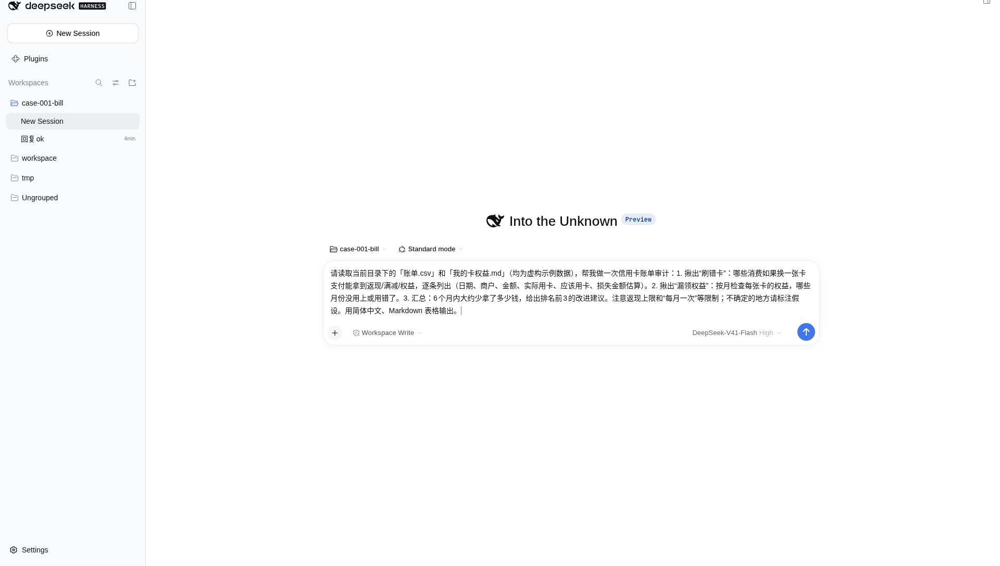
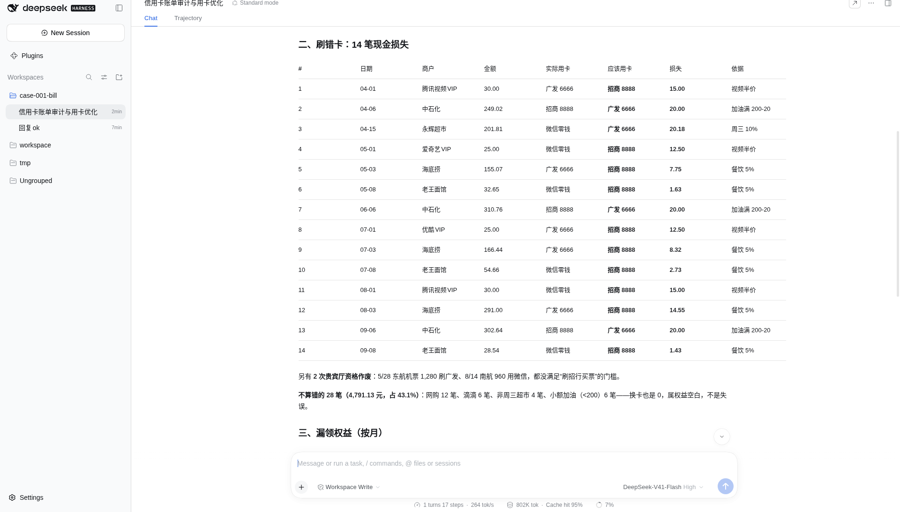
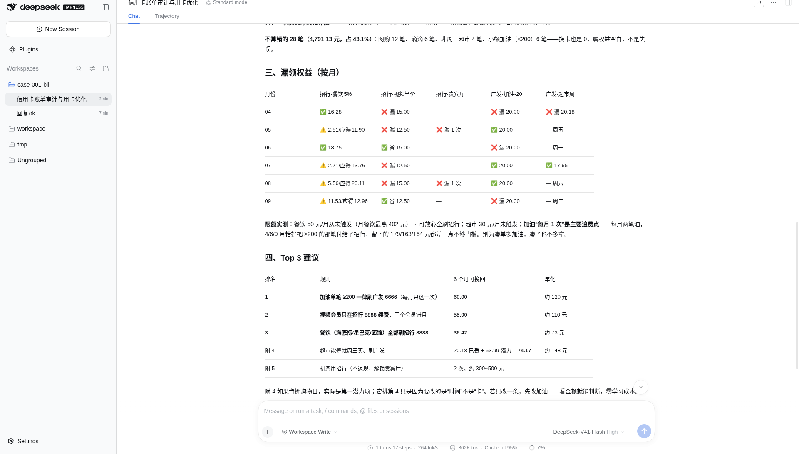

# 信用卡账单乱刷？一句话揪出刷错卡和漏领权益

## 这是干嘛的

卡多了，哪笔该刷哪张，人记不住。
这个案例教你：把账单和卡权益丢给它，让它帮你揪「刷错卡」和「漏领权益」。

示例数据是虚构的，不是真实账单。你拿自己的脱敏账单也能跑。



## 输入

两个文件，放在同一文件夹里：

1. `账单.csv`：日期、商户、类别、金额、支付方式。
2. `我的卡权益.md`：每张卡有什么返现/满减/贵宾厅。

本目录里的两份都是**示例数据，非真实账单**。商户名带「虚构」、卡尾号 8888/6666 是编的，银行名只作示意。

## 输出

1. 刷错卡清单：日期、商户、金额、实际用卡、应该用卡、损失估算。
2. 漏领权益：按月、按卡，哪个月没用上或用错了。
3. 汇总：大约少拿多少钱；排名前 3 的改进建议。
4. 不确定的地方会标假设。

演示结果（以截图为准，读者稿锁定）：

| 实际拿到 | 正确用卡能拿 | 少拿 |
|---|---|---|
| 162.49 元 | 334.09 元 | 171.60 元 |

62 笔样例，约 6 个月。




## 目录里有啥

| 路径 | 是什么 |
|---|---|
| `prompt.md` | 审计提示词原文，哪个平台都能贴 |
| `账单.csv` | 虚构示例账单 |
| `我的卡权益.md` | 虚构卡权益说明 |
| `sample/审计报告.md` | DSH 实跑产出样例 |
| `MANIFEST.md` | 本期文件清单 + 待核 |
| `dsh/` | DeepSeek Harness（DSH）专用配置 |
| `trae/` | Trae 专用配置 |
| `doubao/` | 豆包专用步骤 |
| `screenshots/` | 演示截图；`install/` 是装 DSH 的截图 |

前三个是通用的。后面三个看你用哪个。

## 怎么用

### 通用：最省事的办法

不管哪个平台，把 `账单.csv` 和 `我的卡权益.md` 放进一个文件夹，打开 `prompt.md`，整段复制，贴进对话框。回车。

想用自己的账单：字段对齐（日期/商户/类别/金额/支付方式），先脱敏再贴。别把真卡号、真姓名、真手机号丢进去。

### DSH（DeepSeek Harness）

1. 装：官网 https://www.deepseek.com/zh/download/ 下桌面端；或者装好 Node 后敲 `npm install -g @deepseek-ai/dsh`。
2. 钥匙：去 https://platform.deepseek.com 建一把 API key，贴进 DSH 设置。别发给任何人。下文一律写 `YOUR_API_KEY`，不要把真钥匙写进任何文件。
3. 工作区选放着两份样例的文件夹，权限选可写（workspace-write）——它可能会写出审计报告。
4. 贴 `prompt.md`。

想省掉每次贴提示词，有两种：

- **AGENTS.md（简单）**：把 `dsh/AGENTS.md` 复制到样例文件夹根目录。DSH 每次开会话会自己读它。
- **YAML 预设（进阶）**：在终端进到放 `bill-audit.patch.yml` 的目录，敲
  `dsh web --patch ./bill-audit.patch.yml`
  然后在新任务里选「账单审计（刷错卡/漏领）」这个模式。

装机截图见 `screenshots/install/`。

### Trae

两种，挑一种：

- **规则文件**：把 `trae/.trae` 整个文件夹复制到放样例的文件夹根目录，用 Trae 打开这个文件夹，在对话里说「按规则做账单审计」。
- **自定义智能体**：照 `trae/智能体配置.md` 填表。工具记得勾「阅读」和「文件系统」。

### 豆包

豆包原来的「创建智能体」已经下线了。现在走「豆包工作」：
新工作任务 → 运行环境选「本地电脑」→ 项目里选你的文件夹 → 贴提示词。
细节看 `doubao/工作任务配置.md`。

## 复现（给 agent）

`sample/审计报告.md` 来自 DSH 实跑（2026-10-24 冷启动，`dsh headless` 默认模型），输入样本为虚构。

它在终端里跑，不开 GUI。先读仓根 `AGENTS.md`。

```bash
git clone https://github.com/AKA-qinnashou/qinnashou-dsh-cases.git   # 用户给了别的地址就克隆那个
C=$PWD/qinnashou-dsh-cases/2026-10-21_bill-audit
W=$(mktemp -d)
cp "$C/账单.csv" "$C/我的卡权益.md" "$W/"     # 虚构样本，原名照拷
cp "$C/dsh/AGENTS.md" "$W/"
npm install -g @deepseek-ai/dsh          # 要 Node ≥ 22.18
export DEEPSEEK_API_KEY=YOUR_API_KEY   # 人给；没有就停
cd "$W" && dsh headless "$(cat "$C/prompt.md")"
```

跑完对照（对结构，不对措辞）：

- `$W` 下多出 `审计报告.md`，和 `sample/审计报告.md` 一样有三块：刷错卡表、漏领权益表、汇总 + Top3 建议，另有假设说明。
- 原件没动：`cmp "$C/账单.csv" "$W/账单.csv" && cmp "$C/我的卡权益.md" "$W/我的卡权益.md"`。
- 数字不要求和演示一字不差（模型每次算法可能不同），按下面「验收」抽查。

`dsh/bill-audit.patch.yml` 在 headless 下**不生效**，规矩靠拷进去的 `AGENTS.md`；预设只在 `dsh web` / 桌面端用。默认模型 `deepseek-flash`，换模型见仓根 `AGENTS.md` 第 6 步。

### 人工步骤

1. 建 DeepSeek API key 交给它（或自己 export）。
2. 想看图形界面：自己开桌面端或 `dsh web`，按上面「DSH」节点选。
3. 换真账单前先自己脱敏；改绑卡、办卡自己去银行 App。

## 验收

1. `审计报告.md` 存在，三块齐（刷错卡 / 漏领权益 / 汇总 + Top3）。
2. 刷错卡表抽 3 条手算，损失金额对得上。
3. 「每月一次」「返现上限」没算爆；汇总和分表对得上。
4. 不确定处标了假设。
5. 原件 `cmp` 一致。

## 收工前对一遍

1. 刷错卡表里的金额，抽几条用手算一下。
2. 「每月一次」「返现上限」有没有被算爆。
3. 汇总数字和分表对得上。
4. 标了假设的地方，你认不认。

数字对得上、假设说清楚，才算完。
