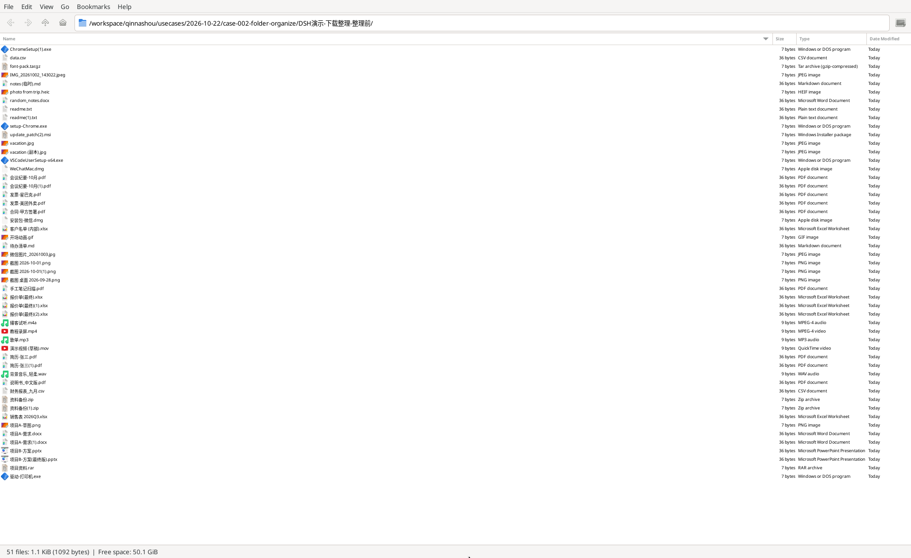
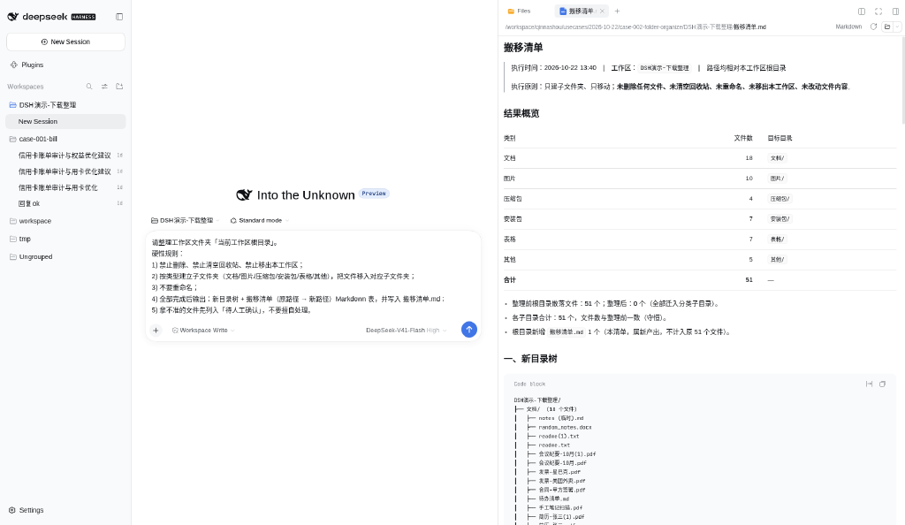
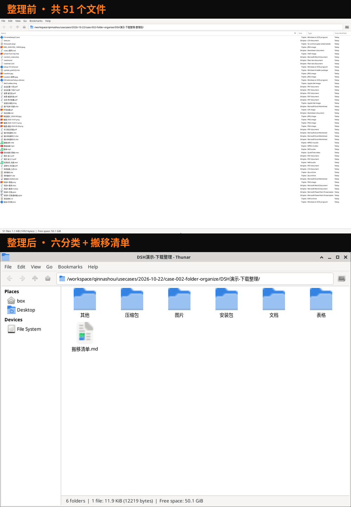

# 下载文件夹乱成粥？一句话让它分好类（只搬不删）

## 这是干嘛的

电脑上的下载文件夹，谁的不乱？
这个案例教你：贴一段话，让它把文件按类型搬进六个子文件夹。

只搬，不删。不改名。拿不准的，先问你。



## 输入

一个乱文件夹。演示用的是「DSH演示-下载整理」，里面 51 个文件：
PDF、图片、表格、压缩包、安装包、音视频，带中文名、空格、括号、(1)(2) 重复编号的都有。

你拿自己的下载文件夹也行。

## 输出

1. 六个子文件夹：文档、图片、压缩包、安装包、表格、其他。
2. 一份搬移清单：每个文件从哪挪到哪。
3. 一张新目录树。

演示结果（以截图07为准）：

| 文档 | 图片 | 压缩包 | 安装包 | 表格 | 其他 | 合计 |
|---|---|---|---|---|---|---|
| 18 | 10 | 4 | 7 | 7 | 5 | 51 |

整理前 51 个，整理后还是 51 个。一个没少。




## 目录里有啥

| 路径 | 是什么 |
|---|---|
| `prompt.md` | 整理提示词原文，哪个平台都能贴 |
| `分类规则.md` | 什么扩展名进哪个夹 |
| `demo-下载/` | 虚构下载文件夹：51 个小占位文件，复现用 |
| `sample/` | DSH 实跑整理后的样子 + `整理报告.md` |
| `MANIFEST.md` | 本期文件清单 + 待核 |
| `dsh/` | DeepSeek Harness（DSH）专用配置 |
| `trae/` | Trae 专用配置 |
| `doubao/` | 豆包专用步骤 |
| `screenshots/` | 演示截图 |

前两个是通用的。后面三个看你用哪个。

## 怎么用

### 通用：最省事的办法

不管哪个平台，打开 `prompt.md`，整段复制，贴进对话框，把「[绝对路径或相对.]」换成你的文件夹。回车。

它中途要是想删东西，你回一句：**禁止删除，只移动。**

### DSH（DeepSeek Harness）

1. 装：官网 https://www.deepseek.com/zh/download/ 下桌面端；或者装好 Node 后敲 `npm install -g @deepseek-ai/dsh`。
2. 钥匙：去 https://platform.deepseek.com 建一把 API key，贴进 DSH 设置。别发给任何人。下文一律写 `YOUR_API_KEY`，不要把真钥匙写进任何文件。
3. 工作区选你要整理的文件夹，权限选可写（workspace-write）。只读的话它搬不动。
4. 贴 `prompt.md`。

想省掉每次贴提示词，有两种：

- **AGENTS.md（简单）**：把 `dsh/AGENTS.md` 复制到要整理的文件夹根目录。DSH 每次开会话会自己读它。
- **YAML 预设（进阶）**：在终端进到放 `downloads-organize.patch.yml` 的目录，敲
  `dsh web --patch ./downloads-organize.patch.yml`
  然后在新任务里选「下载整理（只搬不删）」这个模式。

### Trae

两种，挑一种：

- **规则文件**：把 `trae/.trae` 整个文件夹复制到要整理的文件夹根目录，用 Trae 打开这个文件夹，在对话里说「按规则整理」。
- **自定义智能体**：照 `trae/智能体配置.md` 填表。工具记得勾「终端」和「文件系统」。

### 豆包

豆包原来的「创建智能体」已经下线了。现在走「豆包工作」：
新工作任务 → 运行环境选「本地电脑」→ 项目里选你的文件夹 → 贴提示词。
细节看 `doubao/工作任务配置.md`。

## 复现（给 agent）

`sample/` 来自 DSH 实跑（2026-10-24 冷启动，`dsh headless` 默认模型）：六个子文件夹 + `整理报告.md`；占位文件为虚构。

它在终端里跑，不开 GUI。先读仓根 `AGENTS.md`。`demo-下载/` 是虚构的下载文件夹：51 个小占位文件，名字照截图 07/08 的演示口径。

```bash
git clone https://github.com/AKA-qinnashou/qinnashou-dsh-cases.git   # 用户给了别的地址就克隆那个
C=$PWD/qinnashou-dsh-cases/2026-10-22_downloads-organize
W=$(mktemp -d)
cp -p "$C"/demo-下载/* "$W/"            # 工作区本身就是「下载文件夹」
cp "$C/dsh/AGENTS.md" "$W/"
npm install -g @deepseek-ai/dsh          # 要 Node ≥ 22.18
export DEEPSEEK_API_KEY=YOUR_API_KEY   # 人给；没有就停
cd "$W" && dsh headless "$(sed 's/\[绝对路径或相对\.\]/./' "$C/prompt.md")"
```

跑完对照（对结构，不对措辞）：

```bash
cd "$W"
find . -type f ! -name AGENTS.md ! -name 整理报告.md | wc -l      # 必须 = 51
ls "$C/demo-下载" | while IFS= read -r f; do
  n=$(find . -type f -name "$f" | head -1)
  [ -n "$n" ] && cmp -s "$C/demo-下载/$f" "$n" || echo "缺或变：$f"
done                                                           # 必须无输出
```

- 子文件夹和 `sample/` 一致：文档(18) / 图片(10) / 压缩包(4) / 安装包(7) / 表格(7) / 其他(5)；放进「待人工确认」的允许个别出入，但要在报告里列明。
- 根目录有 `整理报告.md`：新目录树 + 搬移清单（原路径 → 新路径）。
- 文件名一个没改。

`dsh/downloads-organize.patch.yml` 在 headless 下**不生效**，规矩靠拷进去的 `AGENTS.md`。默认模型 `deepseek-flash`，换模型见仓根 `AGENTS.md` 第 6 步。

### 人工步骤

1. 建 DeepSeek API key 交给它（或自己 export）。
2. 想看图形界面：自己开桌面端或 `dsh web`。
3. 整理真下载文件夹前，自己先备份；「待人工确认」里的自己拍板。

## 验收

1. 文件总数前后都是 51，无删除。
2. 每个原文件按名找得到，`cmp` 一致，名字没改。
3. 六个子文件夹齐，归类符合 `分类规则.md`。
4. `整理报告.md` 有新目录树 + 搬移清单。

## 收工前数一遍

1. 整理前多少个文件，整理后各夹加起来还是多少个。少了，立刻停。
2. 回收站里没冒出刚清掉的文件。
3. 抽几个中文名、带括号的，看还在不在。

分类清楚，一个文件都没少，才算完。
