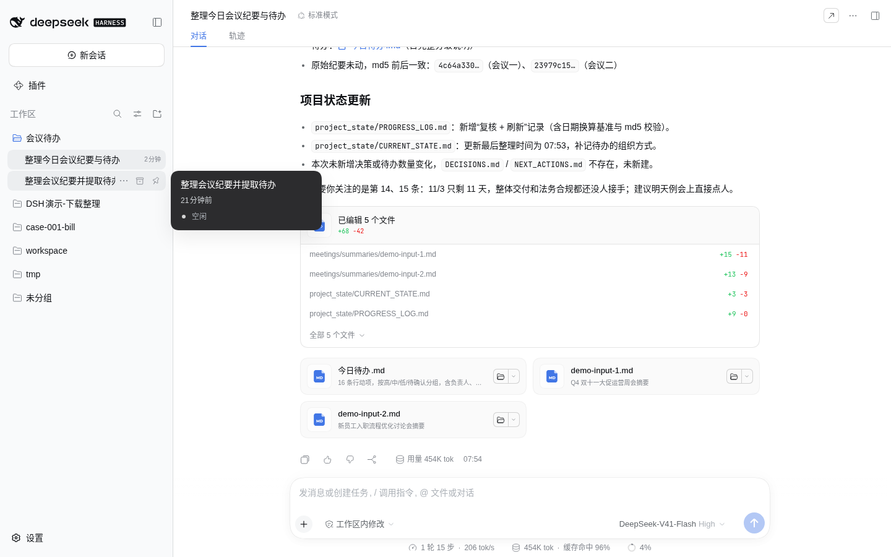
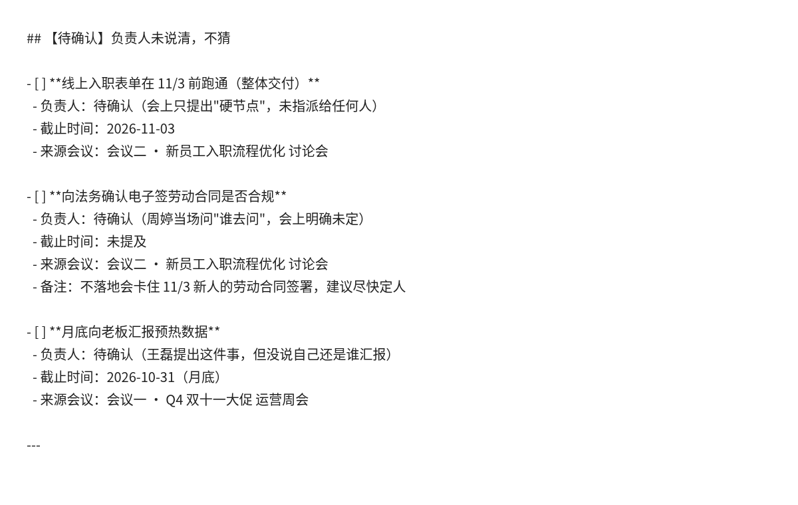
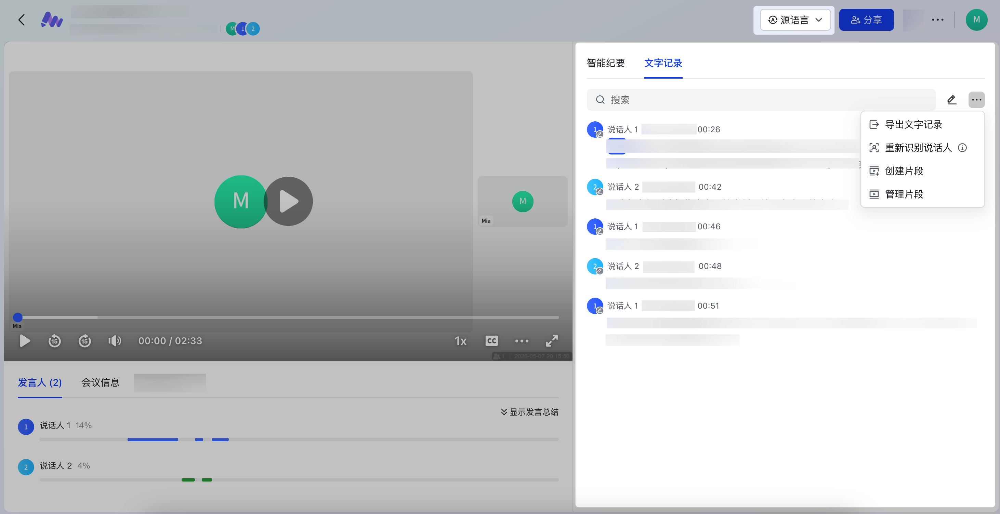
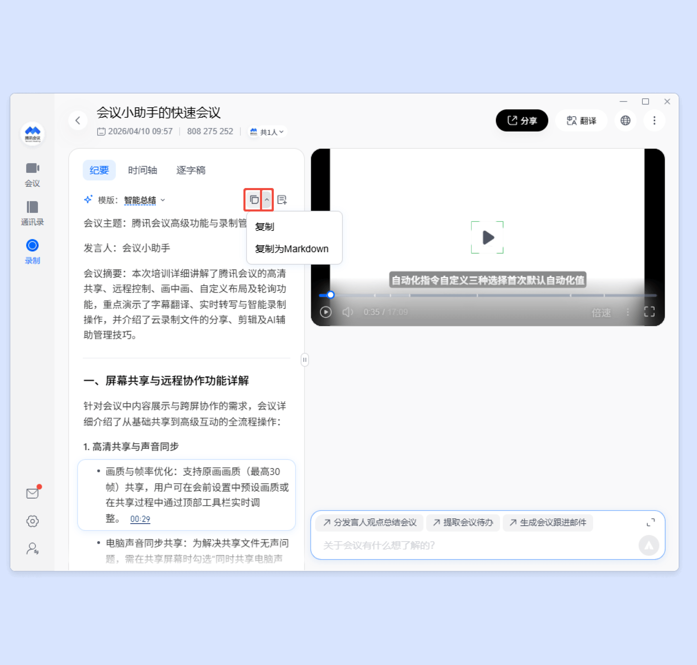
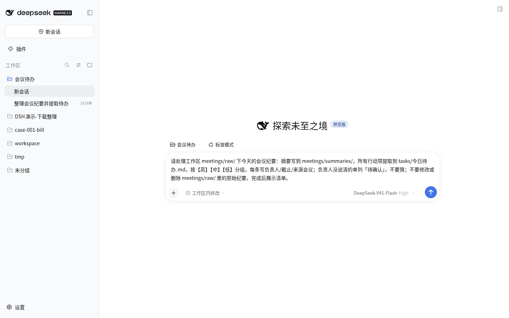

# 会开完了，待办还没影？一段提示词把纪要排成今日清单

## 这是干嘛的

开完会，录音或纪要堆一桌子，主线在哪、谁该干什么，一时理不清。
这个案例教你：把纪要丢进一个文件夹，贴一段话，让它写出摘要，再按高中低排出今日待办。

负责人没说清的，它单列「待确认」，不瞎猜。原始纪要正文一律不改。



## 输入

一个「会议纪要」文件夹。里面可以是：
- 飞书妙记导出的 TXT
- 腾讯会议纪要复制出来的 md/txt
- 自己记的乱笔记

演示用两份**虚构**纪要：双十一运营周会、新员工入职流程讨论会。人名、日期、数字全是编的。根目录 `demo-input-1.md`、`demo-input-2.md` 可直接丢进工作区试跑；完整跑后目录树见 `sample/`。

你拿自己的脱敏纪要也行。别把真姓名、真手机、真合同细节丢进仓或公开场合。

## 输出

1. `meetings/summaries/`：每场会议一份简洁摘要（同名 .md）。
2. `tasks/今日待办.md`：全部行动项，按【高】【中】【低】分组；每条含事项 / 负责人 / 截止 / 来源会议。
3. 负责人未明的进「待确认」。

演示结果（以截图 S6b 为准）：**16 条**（高 7 / 中 3 / 低 3 / 待确认 3），用时约 **1 分 51 秒**，模型 DeepSeek-V41-Flash High。



## 目录里有啥

| 路径 | 是什么 |
|---|---|
| `prompt.md` | 提示词原文，哪个平台都能贴 |
| `优先级判据.md` | 高/中/低/待确认怎么判 |
| `demo-input-1.md` / `demo-input-2.md` | 虚构示例纪要（可直接丢进工作区） |
| `sample/` | 演示跑完后的目录树（raw + summaries + 今日待办） |
| `dsh/` | DeepSeek Harness（DSH）专用配置 |
| `trae/` | Trae 专用配置 |
| `doubao/` | 豆包专用步骤 |
| `screenshots/` | 演示截图；`配图_*` 是公号用的流程/点缀图，非操作步骤 |

前几个是通用的。后面三个看你用哪个。

## 怎么用

### 通用：最省事的办法

1. 建一个文件夹（比如桌面「会议纪要」），把录音转写或纪要 txt/md 丢进去（乱放也行）。
2. 打开 `prompt.md`，整段复制，贴进对话框。回车。
3. 验收时盯「待确认」那一栏，对照会上情况核对；口音重的发言更要核转写。

飞书妙记 / 腾讯会议怎么把文字弄出来，见公号正文；本仓截图：




### DSH（DeepSeek Harness）

1. 装：官网 https://www.deepseek.com/zh/download/ 下桌面端；或者装好 Node 后敲 `npm install -g @deepseek-ai/dsh`。
2. 钥匙：去 https://platform.deepseek.com 建一把 API key，贴进 DSH 设置。别发给任何人。下文一律写 `YOUR_API_KEY`，不要把真钥匙写进任何文件。
3. 工作区选你的「会议纪要」文件夹，权限选可写（workspace-write）——它要建 summaries / tasks。
4. 贴 `prompt.md`。




想省掉每次贴提示词，有两种：

- **AGENTS.md（简单）**：把 `dsh/AGENTS.md` 复制到会议纪要文件夹根目录。DSH 每次开会话会自己读它。
- **YAML 预设（进阶）**：在终端进到放 `meeting-todo.patch.yml` 的目录，敲
  `dsh web --patch ./meeting-todo.patch.yml`
  然后在新任务里选「会议纪要→今日待办」这个模式。

### Trae

两种，挑一种：

- **规则文件**：把 `trae/.trae` 整个文件夹复制到放纪要的文件夹根目录，用 Trae 打开这个文件夹，在对话里说「按规则整理今日待办」。
- **自定义智能体**：照 `trae/智能体配置.md` 填表。工具记得勾「阅读」「文件系统」；要建夹/搬文件再勾「终端」。

### 豆包

豆包原来的「创建智能体」已经下线了。现在走「豆包工作」：
新工作任务 → 运行环境选「本地电脑」→ 项目里选你的文件夹 → 贴提示词。
细节看 `doubao/工作任务配置.md`。

## 复现（给 agent）

`sample/` 为本期演示产出（纪要虚构）；2026-10-24 冷启动 `dsh headless` 实跑结构与之一致。

它在终端里跑，不开 GUI。先读仓根 `AGENTS.md`。

```bash
git clone https://github.com/AKA-qinnashou/qinnashou-dsh-cases.git   # 用户给了别的地址就克隆那个
C=$PWD/qinnashou-dsh-cases/2026-10-24_meeting-todo
W=$(mktemp -d)
cp "$C"/demo-input-*.md "$W/"            # 虚构纪要，原名照拷（和 sample/ 对得上）
cp "$C/dsh/AGENTS.md" "$W/"
npm install -g @deepseek-ai/dsh          # 要 Node ≥ 22.18
export DEEPSEEK_API_KEY=YOUR_API_KEY   # 人给；没有就停
cd "$W" && dsh headless "$(cat "$C/prompt.md")"
```

跑完对照（对结构，不对措辞）：

- 结构：`meetings/raw/`(2)、`meetings/summaries/`(2，同名 .md)、`tasks/今日待办.md`，和 `sample/` 一致。
- 原件没动：`for f in demo-input-1.md demo-input-2.md; do cmp "$C/$f" "$W/meetings/raw/$f"; done`。
- `今日待办.md` 有【高】【中】【低】分组和「待确认」栏；条数可和演示不同。

`dsh/meeting-todo.patch.yml` 在 headless 下**不生效**，规矩靠拷进去的 `AGENTS.md`。默认模型 `deepseek-flash`，换模型见仓根 `AGENTS.md` 第 6 步。

### 人工步骤

1. 建 DeepSeek API key 交给它（或自己 export）。
2. 想看图形界面：自己开桌面端或 `dsh web`。
3. 飞书妙记 / 腾讯会议导出纪要自己点；真会议先脱敏；「待确认」自己对着会上过，派活自己发。

## 验收

1. 结构和 `sample/` 一致。
2. `raw/` 原件 `cmp` 一致。
3. 每条待办有事项 / 负责人 / 截止 / 来源；没提到的写「未提及」，没编。
4. 负责人不清的在「待确认」，没被猜成某人。

## 收工前对一遍

1. 「待确认」栏对着会上过一遍，别直接派活。
2. 抽几条高优先级，核负责人和截止有没有被编出来。
3. `meetings/raw/`（或你丢进去的原件）正文没被改。
4. 口音重的发言，对照转写再核一次。

待确认对得上、原件没动，才算完。


