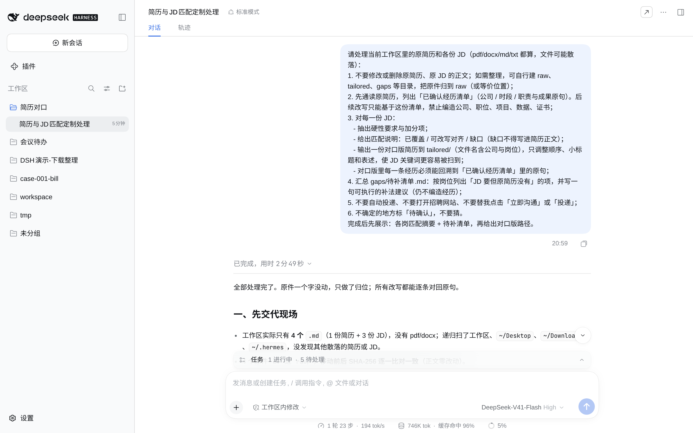

# 一份简历投多个岗？按 JD 改出对口版，经历一条不编

## 这是干嘛的

手上一份通用简历，想投的岗位 JD 各不一样。
这个案例教你：把原简历和几份 JD 丢进一个文件夹，贴一段提示词，让它按每份 JD 改出一份对口版简历，并把「JD 要、简历里没有」的能力单列成待补清单。

红线两条：不编经历，不自动投递。

## 输入

一个「简历对口」文件夹：
- 原简历一份（pdf / docx / md / txt）
- JD 每岗一个 txt 或 md

演示用**虚构**样本：简历 1 份（`简历-原件.md`）、JD 3 份（`JD-*.md`）。人名、公司、数字全是编的，可直接丢进工作区试跑。

## 输出

1. `已确认经历清单.md`：从原简历摘出的经历原句。
2. `match/`：每岗匹配说明（已覆盖 / 可改写对齐 / 缺口）。
3. `tailored/`：每岗一份对口版简历。
4. `gaps/待补清单.md`：按岗位列缺口 + 补法建议。

演示：DSH 用时 **2分49秒**，模型 DeepSeek-V41-Flash（High）。完整跑后目录见 `sample/`。

## 目录里有啥

| 路径 | 是什么 |
|---|---|
| `prompt.md` | 提示词原文 |
| `简历-原件.md` / `JD-*.md` | 虚构示例输入 |
| `sample/` | 演示跑完后的产出 |
| `dsh/AGENTS.md` | DSH 工作区规矩 |
| `screenshots/` | 演示截图；`配图_*` 是公号用的流程/奶油球图，非操作步骤 |

## 怎么用

1. 建「简历对口」文件夹，原简历 + JD 丢进去。
2. 打开 DSH 客户端，把这个文件夹选成工作区。
3. 打开 `prompt.md`，整段贴进对话框。
4. 验收：对照原简历，看对口版里每一条能不能在原件找到依据；缺口看 `gaps/待补清单.md`。
5. 投递在招聘 App 里自己点。

Trae / 豆包 本期未实测，只放了 DSH 配置。
