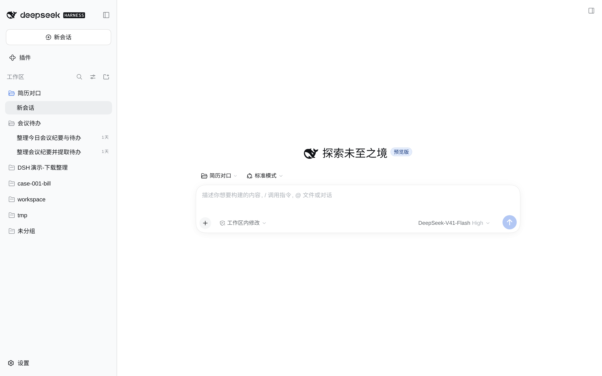
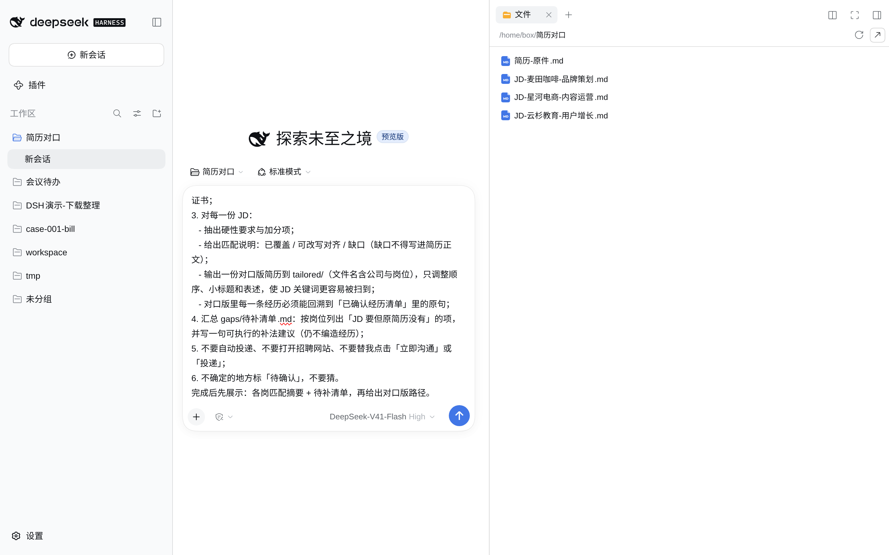
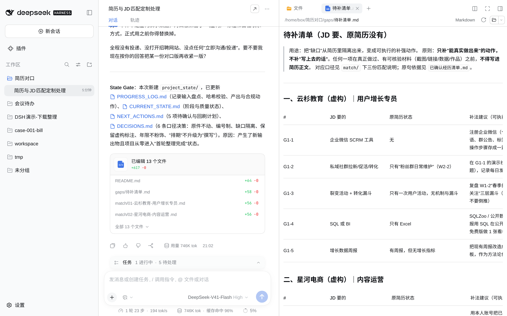

# 简历 × JD：按岗改对口版，缺口单列，经历不编

## 场景

一份简历，投三个岗，JD 各不一样。
丢进一个文件夹，贴一段提示词。它按每份 JD 出一份对口版简历，JD 要、简历没有的，单列进待补清单。

两条红线：不编经历；不替你投递。

> 声明：本目录所有简历、JD、产出样例均为**虚构**（人名、公司、电话、邮箱、数字全是编的）。别把真简历、真手机号丢进公开仓。


## 输入

一个文件夹（演示叫「简历对口」）：
- 原简历 1 份：pdf / docx / md / txt
- JD 每岗 1 个：txt / md

本目录自带虚构样本，可直接丢进去试跑：`demo-简历-原件.md`、`demo-JD-*.md`（3 份）。

## 输出

| 产出 | 内容 |
|---|---|
| `已确认经历清单.md` | 从原简历摘出的经历原句，后面只许用它 |
| `match/` | 每岗一份：已覆盖 / 可改写对齐 / 缺口 |
| `tailored/` | 每岗一份对口版简历（文件名含公司+岗位） |
| `gaps/待补清单.md` | 按岗列缺口 + 一句补法 |
| `raw/` | 原件归位，正文不动 |

演示实测（DSH）：3 份 JD，用时 2 分 49 秒，模型 DeepSeek-V41-Flash High。跑完的完整目录见 `sample/`。

## 目录

| 路径 | 是什么 | 层 |
|---|---|---|
| `prompt.md` | 提示词原文 | 通用 |
| `改写判据.md` | 已覆盖/可改写/缺口/待确认怎么判 | 通用 |
| `demo-简历-原件.md`、`demo-JD-*.md` | 虚构输入 | 通用 |
| `sample/` | 演示跑完的产出 | 通用 |
| `dsh/` | AGENTS.md + `--patch` 预设 | DSH |
| `trae/` | 规则文件 + 智能体填表 | Trae |
| `doubao/` | 豆包工作 · 本地电脑步骤 | 豆包 |
| `screenshots/` | 演示截图（DSH） | — |

## 怎么用

### 通用

1. 建文件夹，原简历 + JD 丢进去。
2. 整段复制 `prompt.md`，贴进对话框，回车。
3. 按下面「验收」过一遍。

### DSH（DeepSeek Harness）

1. 装：官网 https://www.deepseek.com/zh/download/ 下桌面端；或 `npm install -g @deepseek-ai/dsh`。
2. 钥匙：https://platform.deepseek.com 建 API key，贴进 DSH 设置。本仓一律写 `YOUR_API_KEY`，真钥匙别进任何文件。
3. 工作区选「简历对口」，权限选工作区内修改（workspace-write）——它要建 raw / match / tailored / gaps。
4. 贴 `prompt.md`。




不想每次贴：
- **AGENTS.md**：把 `dsh/AGENTS.md` 拷到「简历对口」根目录，它每次开会话自己读。
- **YAML 预设**：终端进 `dsh/`，敲 `dsh web --patch ./resume-jd.patch.yml`，新任务里选「简历×JD→对口版」模式。

### Trae

二选一：
- **规则文件**：把 `trae/.trae` 整个拷到「简历对口」根目录，用 Trae 打开这个文件夹，说「按规则改对口版简历」。
- **自定义智能体**：照 `trae/智能体配置.md` 填。工具勾「阅读」「文件系统」，要建夹搬文件再勾「终端」。

本流程未在 Trae 实测。

### 豆包

「创建智能体」已下线（第三方报道），走「豆包工作」：
新工作任务 → 运行环境「本地电脑」→ 项目选「简历对口」→ 贴提示词。细节见 `doubao/工作任务配置.md`。

本流程未在豆包实测。

## 复现（给 agent）

它在终端里跑，不开 GUI。先读仓根 `AGENTS.md`。

```bash
git clone https://github.com/AKA-qinnashou/qinnashou-dsh-cases.git   # 用户给了别的地址就克隆那个
C=qinnashou-dsh-cases/2026-10-25_resume-jd
W=$(mktemp -d)
for f in "$C"/demo-*.md; do b=$(basename "$f"); cp "$f" "$W/${b#demo-}"; done
cp "$C/dsh/AGENTS.md" "$W/"
npm install -g @deepseek-ai/dsh          # 要 Node ≥ 22.18
export DEEPSEEK_API_KEY=YOUR_API_KEY   # 人给；没有就停
cd "$W" && dsh headless "$(sed -n '/^```$/,/^```$/p' "$OLDPWD/$C/prompt.md" | sed '1d;$d')"
```

跑完对照：

- 结构：`$W` 下有 `已确认经历清单.md`、`raw/`(4)、`match/`(3)、`tailored/`(3)、`gaps/待补清单.md`，和 `sample/` 一致。文件名措辞可不同。
- 内容：按下面「验收」5 条过。
- `raw/` 原件和 `demo-*` 逐字节一致：`diff` 一下。

模型：演示用 DeepSeek-V41-Flash High。headless 默认用 `deepseek-flash`（DeepSeek-V4.1-Flash），reasoningEffort 为 high。要换模型，用 `--patch` 覆盖 `agent-default-model` 的 `config.model`，例如改成 `deepseek-v4-pro`；写法见仓根 `AGENTS.md` 第 6 步。
`--patch ./resume-jd.patch.yml` 在 headless 下**不生效**：headless 不组合 agent preset，实测会话里没有任何该预设的痕迹。所以 headless 靠 `AGENTS.md` 定规矩，预设只在 `dsh web` 或桌面端里用。

实测冷启动（2026-10-24，干净环境，DSH 0.2.1-rc.2，Node 22.21）：dsh headless 本身用时约 3 分 21 秒，结构与 `sample/` 一致，`raw/` 4 份原件逐字节未变。

### 人工步骤

1. 建 DeepSeek API key 交给它（或自己 export）。
2. 想看图形界面：自己开桌面端或 `dsh web`，按上面「DSH」节点选。
3. 换真简历前先自己脱敏；投递自己点。

## 验收

1. 对口版每一条，在 `已确认经历清单.md` 里找得到原句。找不到就删。
2. 数字没变大，职责没升级（「协助」没变成「主导」）。
3. 缺口只在 `gaps/`，没混进 `tailored/`。
4. `raw/` 原件正文没动。
5. 投递在招聘 App 里自己点。


